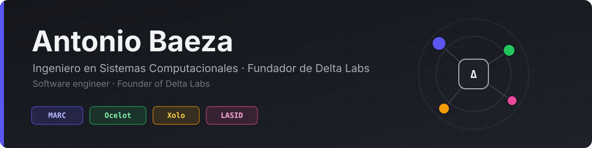
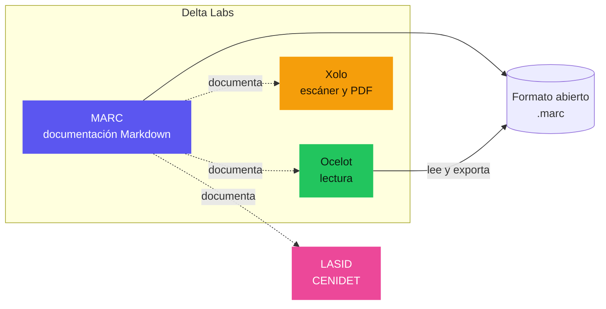

  

  
  
  
  

**Español** · [English](#english)

## Quién soy

Soy ingeniero en Sistemas Computacionales por el Tecnológico Nacional de México y fundador de **Delta Labs**, donde diseño y construyo software propio de principio a fin: el núcleo, las aplicaciones de escritorio y móviles, la documentación técnica y la publicación en tiendas. Me interesan los sistemas que funcionan sin conexión, respetan los datos de quien los usa y se pueden mantener durante años.

Trabajo con una regla sencilla: cada producto tiene un núcleo compartido escrito una sola vez, interfaces nativas en cada plataforma y documentación de ingeniería que describe cómo está construido hoy, verificada contra el código.

## Lo que construyo

El siguiente diagrama muestra cómo se relacionan los proyectos actuales. MARC define el formato de documentación que usan todos los demás, y los productos de Delta Labs comparten la misma forma de trabajar: núcleo nativo con frontera bien definida e interfaz en Kotlin.

| Proyecto | Qué es | Tecnología |
|:--|:--|:--|
| **MARC** | Editor y visor de documentación Markdown con diagramas, fórmulas, gráficas e interacción, para escritorio y Android, con exportación a PDF y Word. Su formato `.marc` es abierto ([especificación](https://github.com/Anton-Bazh/MARC-FORMATO)) y su documentación de uso es pública ([MARC-DOC](https://github.com/Anton-Bazh/MARC-DOC)). | Rust, Kotlin Multiplatform, Compose, Typst |
| **Ocelot** | Aplicación de lectura para Android: libros, cómics, manga, webtoons y revistas en una sola biblioteca, con lectura en voz alta. | Rust (31 motores de formato), UniFFI, Jetpack Compose, SQLite |
| **Xolo** | Escáner de documentos y suite PDF para Android que trabaja por completo en el teléfono, sin permiso de red. | C++17 (motor Eagle), OpenCV, Kotlin hexagonal, Jetpack Compose |
| **LASID** | Laboratorio virtual de sistemas dinámicos e inteligencia artificial, desarrollado como residencia en CENIDET. | Next.js, React, Prisma, PostgreSQL |

> Los repositorios de código son privados; MARC-DOC, MARC-FORMATO y MARC-DOC-TRADUCCIONES son públicos.

## Herramientas

  
  
  
  
  
  
  
  
  
  
  
  
  
  

## Cómo pienso y resuelvo

Ante un problema, primero entiendo qué necesita realmente quien lo tiene y qué pasa si no se resuelve; después busco la solución más simple que lo resuelva por completo. Prefiero diagnosticar con evidencia, leyendo el código, reproduciendo el fallo y midiendo, antes que suponer. Cuando hay varias salidas, comparo su costo, su riesgo y lo que cuesta mantenerlas, propongo un plan por puntos y lo acuerdo antes de ejecutarlo. Termino lo que empiezo, incluida la parte que no se ve: pruebas, documentación y entrega.

1. **Entender antes de construir.** El problema real casi nunca es el primero que se describe; preguntar y observar ahorra semanas.
2. **Lo simple que funciona completo.** Menos piezas significa menos fallas y un sistema que otra persona puede mantener.
3. **Decisiones con evidencia.** Diagnóstico sobre el código y los datos, no sobre suposiciones; cada decisión importante queda registrada con su motivo.
4. **Calidad de punta a punta.** Seguridad, privacidad y confiabilidad se diseñan desde el inicio, no se agregan al final.
5. **Aprender rápido lo que el problema exija.** Del núcleo en Rust a la publicación en tiendas, adopto la herramienta que el proyecto necesita.

### Cómo lo aplico en mis proyectos

- **Núcleo una vez, interfaz nativa en cada plataforma.** La lógica vive en Rust o C++ y se expone con una frontera explícita (UniFFI, JNI).
- **Sin conexión por defecto.** Los datos se quedan en el dispositivo salvo que la función exija lo contrario.
- **Documentación como parte del producto.** Cada proyecto tiene su repositorio de ingeniería, escrito en presente y verificado contra el código.
- **Publicar es parte del trabajo.** Firma, cumplimiento y fichas de Google Play y Huawei AppGallery reciben el mismo cuidado que el código.

## Contacto

Escríbeme a [contacto@devlta.com](mailto:contacto@devlta.com) visita [devlta.com](https://devlta.com) o búscame en [LinkedIn](https://www.linkedin.com/in/antoniobaezat/).

---

## English

I am a Computer Systems Engineer (Tecnológico Nacional de México) and the founder of **Delta Labs**, where I design and build our own software end to end: native cores, desktop and mobile apps, engineering documentation and store releases. I care about software that works offline, respects its users' data and can be maintained for years.

| Project | What it is | Stack |
|:--|:--|:--|
| **MARC** | Markdown documentation editor and viewer for desktop and Android, with diagrams, math, charts and PDF/Word export. Open `.marc` format ([spec](https://github.com/Anton-Bazh/MARC-FORMATO)), public user docs ([MARC-DOC](https://github.com/Anton-Bazh/MARC-DOC)). | Rust, Kotlin Multiplatform, Compose, Typst |
| **Ocelot** | Android reading app: books, comics, manga, webtoons and magazines in one library, with read-aloud. | Rust (31 format engines), UniFFI, Jetpack Compose, SQLite |
| **Xolo** | Offline document scanner and PDF suite for Android, with no network permission. | C++17 (Eagle engine), OpenCV, hexagonal Kotlin, Jetpack Compose |
| **LASID** | Virtual lab for dynamical systems and AI, built during my residency at CENIDET. | Next.js, React, Prisma, PostgreSQL |

**How I think.** I start by understanding what the person with the problem actually needs, then look for the simplest solution that solves it completely. I diagnose with evidence (reading the code, reproducing the failure, measuring) rather than assumptions, weigh options by cost, risk and maintenance, agree on a plan and finish the whole job, including tests, documentation and delivery.

**How it shows in my projects.** One shared native core with native UI per platform, offline by default, security and privacy designed in from the start, and engineering docs that describe the system as it is today.

Reach me at [contacto@devlta.com](mailto:contacto@devlta.com) · [devlta.com](https://devlta.com) · [LinkedIn](https://www.linkedin.com/in/antoniobaezat/)
